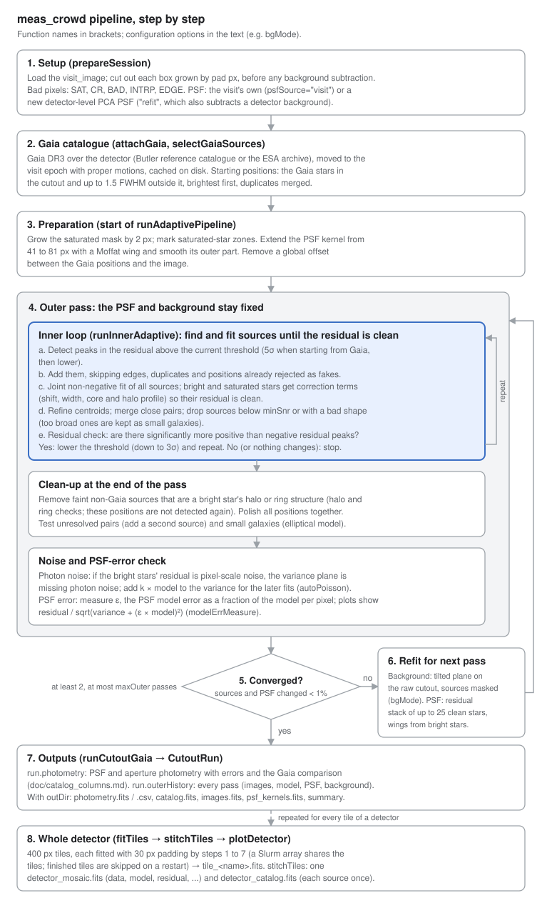

# meas_crowd: pipeline guide

How the pipeline works, its key options, a recipe for every diagnostic plot, and how to run and
check the unit tests.  Every step's details, reasons and decision rules are in
[algorithm.md](algorithm.md).  The output catalogue's columns are described in
[catalog_columns.md](catalog_columns.md), every function's parameters and return values in
[function_reference.md](function_reference.md).

- [Pipeline overview](#pipeline-overview)
- [Key parameters and options](#key-parameters-and-options)
- [How-to recipes](#how-to-recipes)
- [Unit tests: running them and checking the results](#unit-tests-running-them-and-checking-the-results)

## Pipeline overview

The pipeline fits every star in a crowded field jointly with a PSF model, starting from Gaia
positions. It alternates between finding sources and improving the PSF and background until
neither changes. It runs on one cutout at a time. A whole detector is a grid of cutouts (tiles)
whose results are stitched back together.


Steps 4–6 repeat until the source count and the PSF each change by less than 1%; a
whole-detector run repeats steps 1–7 for every tile.  The same flow with a description of every
step:

<details>
<summary><b>Detailed flow diagram</b> (click to open)</summary>



</details>

1. **Setup** (`prepareSession`): loads the `visit_image` from the Butler. Cuts out each
   requested box grown by `pad` px, before any background subtraction. Builds the bad-pixel mask
   (SAT, CR, BAD, INTRP, EDGE) and sets up the detector-level PSF, either the visit's own PSF or a
   fresh refit (see [Key parameters](#key-parameters-and-options)).
2. **Gaia catalogue** (`attachGaia`, `selectGaiaSources`): Gaia DR3 sources over the detector, moved to
   the visit epoch with their proper motions and cached on disk. Sources up to 1.5 FWHM outside a
   cutout are kept, so stars just over the edge are modelled.
3. **Preparation** (start of `runAdaptivePipeline`): grows the saturated mask by 2 px and marks
   saturated-star zones. Extends the PSF kernel from 41 to 81 px with a Moffat wing and smooths
   its outer part. In refit mode it subtracts the detector-level background. It also removes a
   global Gaia-vs-image offset.
4. **Outer pass** (repeated): one full fit with the PSF and background held fixed.
    1. **Inner loop** (`runInnerAdaptive`), repeated until the residual is clean:
        1. detect peaks in the residual above the current threshold;
        2. add them, skipping edges, duplicates and positions already rejected as fakes;
        3. fit all sources jointly (non-negative least squares); bright and saturated stars get
           extra correction terms (shift, width, core and halo profile) in every fit;
        4. refine the centroids, merge close pairs, and drop sources below `minSnr` or with a
           bad shape (too-broad ones are kept as small galaxies);
        5. residual check: are there significantly more positive than negative residual peaks?
           If yes, lower the threshold (from 5σ when starting from Gaia to a 3σ floor; later passes start
           at the floor) and repeat; if no, or nothing changes any more, stop.
    2. **Clean-up at the end of the pass**: remove faint non-Gaia sources that are part of a bright
       star's halo or ring pattern (the halo and ring checks; these positions are not detected
       again in later passes), polish all positions together, then test for unresolved pairs
       (add a second source) and small galaxies (elliptical model).
    3. **Noise and PSF-error check**: two measurements made on the finished pass.
        - *Missing photon noise* (`autoPoisson`): if the residual around bright stars is
          pixel-to-pixel noise larger than the variance plane predicts, the variance plane is
          missing the stars' own photon noise.  The pipeline then adds k × model to the variance
          for the following fits, so bright stars are not over-weighted and their noise is not
          mistaken for new sources.
        - *PSF model error* (`modelErrMeasure`): measures ε, how far the PSF model is from the
          real stars as a fraction of the model in each pixel.  It is stored with the pass
          (`modelErr`) and used by the residual/σ plots, which divide by
          sqrt(variance + (ε × model)²).  The fit itself keeps `sysFrac` unless
          `fitSysFromData=True`.
5. **Convergence test**: stop when the source count changed by less than 1% and the PSF by less
   than 1% (after at least 2 passes and at most `maxOuter`). Otherwise go to step 6.
6. **Refit for the next pass**: re-derive the background from the raw cutout with this pass's
   model masked (a sigma-clipped tilted plane by default, `bgMode`). Update the PSF from a
   residual stack of up to 25 clean stars, then measure its wings from the bright stars. Return
   to step 4.
7. **Outputs** (`runCutoutGaia` → `CutoutRun`): the full history of every pass
   (`run.outerHistory`), the photometry catalogue with the Gaia comparison (`run.photometry`), a
   summary, and with `outDir` files on disk (`saveRun`: `photometry.fits`, images, PSF kernels).
8. **Whole detector** (`fitTiles` → `stitchTiles` → `plotDetector`): 400 px tiles, each fitted
   with 30 px padding and written to `tile_<name>.fits` (DATA, MODEL, RESIDUAL, RESIDUAL_SIGMA,
   VARIANCE, BAD and the catalogue). These are stitched into `detector_mosaic.fits` (the same
   images plus TILE) and one catalogue in which each source appears once.

Why each step is there and the exact rules behind its decisions (thresholds, what is kept or
removed, and when) are in [algorithm.md](algorithm.md).

The diagrams are drawn by `doc/images/make_flow_diagrams.py`; edit the text there and rerun it
to change them.

The DATA image in every output is the image the fit used, after background subtraction, so
residual = data − model.

## Key parameters and options

Names follow the Rubin DM conventions: functions, options and catalogue columns are camelCase
(`runSessionGaia`, `maxOuter`, `psfMag`).  The snake_case names of older versions
(`run_session_gaia`, `max_outer`, old configuration JSON files) still work and raise a
`FutureWarning` with the new name.

The most important choice is the PSF source; everything else has a working default in
`CROWDED_FIELD_CONFIG` (formerly `V5_TESTING_CONFIG`, which still works). Options are passed to
`makeConfig(...)` or as keyword overrides to `runSessionGaia(sess, cfg, maxOuter=3, ...)`;
an unknown name raises an error. `crowd.PIPELINE_DEFAULTS` lists every option with a comment, and
`crowd.showConfig(cfg, diffOnly=True)` prints what differs from the defaults.

For dense stellar fields (Galactic bulge and plane) use `CROWDED_STELLAR_FIELD_CONFIG`:
`CROWDED_FIELD_CONFIG` with the PSF residual-stack refit allowed to use less isolated stars
(`psfStackIsoFwhm=1.0`, `psfStackMinSnr=30`, `psfStackN=80`) and every source fitted as a point
source (`ellipTest=False`, `keepExtended=False`).  With the default isolation rule only a star or
two qualify in such a field, so the PSF is never refined; extended models then absorb the PSF
mismatch.  On LSSTCam detector 144 of visit 2025062100433 it lowered the residual/σ scatter of
the crowded tiles (e.g. 2.39 → 1.40) and halved the scatter against Gaia, and it is the default
of the `crowdDetector.py` command line.

**PSF source** (`prepareSession(..., psfSource=...)`, also `fitTiles` and the
`crowdDetector.py` CLI):

- `"visit"` (recommended, CLI default): use the PSF stored with the `visit_image`. Fast. The
  visit image is already background-subtracted, so pass 1 starts with no extra background.
- `"refit"`: build a new detector-level PSF: subtract an Akima-spline background, detect at 3σ,
  select stars by size (`ObjectSizeStarSelectorTask`) and fit a PCA PSF (spatial order 1, 512 px
  cells). The background is kept as `session.bgImage` and subtracted in pass 1; the candidate and
  used stars are kept as `session.starCat` and `session.psfUsedXy`.

In both cases the PSF is then refitted inside each cutout between passes with PIFF (`refitPsf`).

| Option | Default | What it controls |
| --- | --- | --- |
| `pad` (`prepareSession`) | 0 (examples use 20) | Extra px fitted around each cutout so edge stars have their neighbours |
| `refitPsf` | `"piff"` | PSF update between passes: `"piff"` (the Rubin pipelines' PIFF determiner on neighbour-subtracted clean stars, `piffStampSize`, `piffSpatialOrder`; the pass's PSF is kept if PIFF fails) or `False` (keep the PSF) |
| `psfStackN`, `psfStackMinSnr` | 25, 50 | Number and minimum peak S/N of the clean stars given to PIFF |
| `psfWingSize`, `psfExtBlend` | 81 px, (12, 16) px | Kernel size after the wing extension and the radii of the Moffat blend |
| `wingsFromStars` | True | Measure the outer wings from bright and saturated stars |
| `minOuter`, `maxOuter` | 2, 6 (CLI 3) | Number of outer passes |
| `outerGrowthTol`, `psfTol` | 0.01, 0.01 | Convergence: change in source count and in the PSF kernel |
| `maxInner` | 30 (CLI 15) | Cap on inner iterations per pass |
| `gaiaThresholdStart` | 5.0 σ | First detection threshold when the fit starts from Gaia positions |
| `innerKwargs` | start 8, step −1, floor 3 σ | Detection thresholds without Gaia, and the floor |
| `minSnr` | 3.0 | Minimum S/N to keep a source |
| `gmagMax` (`runSessionGaia`) | None | Start only from Gaia stars brighter than this G magnitude |
| `fitGaiaOffset`, `gaiaMaxDriftPx` | True, 1.5 px | Remove a global WCS offset; how far a Gaia source may move from its Gaia position |
| `subtractInitialBg` | True | Subtract `session.bgImage` in pass 1 (refit mode only) |
| `bgMode` | `"plane"` | Background refit between passes: `"plane"` (sigma-clipped tilted plane), `"constant"`, `"spline"` (`SubtractBackgroundTask` surface; can swing in the corners of a small, heavily masked cutout) or `"none"` |
| `bgBinSize`, `bgSatMaskFwhm` | 32 px, 6 FWHM | Spline background grid; mask around saturated stars |
| `satGrowPx`, `nearSatFrac` | 2 px, 0 (off) | Grow the SAT mask; mask near-saturated cores |
| `brightCorr` | True | Per-star shift, width and radial-profile terms for bright stars |
| `dropHaloMimics`, `dropRingMimics` | True | Remove faint non-Gaia sources that look like halo / ring structure of a bright star (and block them from re-detection) |
| `splitTest`, `ellipTest`, `keepExtended` | True | Unresolved pairs, elliptical galaxies, broadened-PSF galaxies |
| `finalPolish` | True | Joint position polish at the end of each inner loop |
| `autoPoisson`, `modelErrMeasure` | True | Add missing photon noise; measure the PSF model error |
| `fastStamps` | True | C++ stamp rendering (NumPy fallback), checked against the stack |
| `keepAllFits` | False | Keep every iteration's per-source stamps (needed for source pages of earlier iterations) |
| `nJobs` (`runSessionGaia`) | 1 | Fit cutouts in parallel processes |
| `tile`, `pad` (`fitTiles`) | 400, 30 px | Tile interior size and padding for whole-detector runs |

## How-to recipes

Every recipe below uses functions in the package. Items 2–5 need a cutout run held in memory
(`runs` from `runSessionGaia`). Tile runs keep only the final images and catalogue, so for
stage plots of a detector region, run that region as a cutout. `examples/run_sample.py`
(terminal) and `examples/run_sample.ipynb` (notebook) run all of them in one go.

### 1. Run the whole pipeline

At USDF, from a terminal (build once with `scons`):

```bash
source /sdf/group/rubin/sw/w_latest/loadLSST.bash
setup lsst_distrib
cd ~/meas_crowd && setup -k -r . && scons
```

A Jupyter kernel does not see `setup -k -r .`; the first cell of `examples/run_sample.ipynb`
puts the checkout on the path itself.

Cutouts, in Python or a notebook. Load the visit image yourself so you can reuse it for plots:

```python
import lsst.meas.crowd as crowd
from lsst.daf.butler import Butler

VISIT, DET = 2025062100433, 144
butler = Butler("dp2_prep", collections="LSSTCam/runs/DRP/DP2")
refs = butler.query_datasets("visit_image", collections="LSSTCam/runs/*", find_first=False,
                             where=f"instrument='LSSTCam' AND visit={VISIT} AND detector={DET}")
visitImage = butler.get(refs[0])

cfg = crowd.makeConfig(crowd.CROWDED_FIELD_CONFIG)
sess = crowd.prepareSession(VISIT, DET, cutouts=["1000,1000,300", "2500,2000,300"], pad=20,
                             psfSource="visit",        # or "refit"
                             visitImage=visitImage)
crowd.attachGaia(sess, visitImage=visitImage)          # Gaia DR3 catalogue, cached in gaia_cache/
runs = crowd.runSessionGaia(sess, cfg, outDir="results", maxOuter=3, maxInner=15)
run = runs[next(iter(runs))]
crowd.report(run)                                         # what each pass did
phot = run.photometry                                     # PSF + aperture magnitudes + Gaia comparison
crowd.plotGaiaComparison(phot)                          # (saved as results/.../photometry.fits)
```

The whole detector as a Slurm array (25 tasks share the 110 tiles, then one stitch job):

```bash
VISIT=2025062100433 DETECTOR=144 bash examples/usdf_detector_array.sh
```

Or step by step (`--region` limits a test run to a few tiles):

```bash
OUT=$HOME/meas_crowd_results/v2025062100433_d144
python bin.src/crowdDetector.py fit 2025062100433 144 --out $OUT --region 1000 1800 1000 1800
python bin.src/crowdDetector.py stitch --out $OUT
python bin.src/crowdDetector.py plot --out $OUT
```

`--out` is optional: without it the results go to `$MEAS_CROWD_OUT` if that is set, else to
`DEFAULT_OUT` at the top of `bin.src/crowdDetector.py` (edit it to change the default).
[command_line.md](command_line.md) walks through a whole-detector run at USDF step by step.

### 2. PSF candidate stars and the model PSF

`psfStarPositions` returns candidate and used stars from one of three PSF determinations;
`showPsfStars` draws them on an image next to the PSF kernel and its radial profile.

```python
# a) detector-level PSF, psfSource="refit": stars the PCA PSF was built from
stars = crowd.psfStarPositions(session=sess)
crowd.showPsfStars(visitImage, stars, psf=sess.psf)

# b) the visit's own PSF, psfSource="visit": stars flagged calib_psf_candidate / calib_psf_used
#    (the dataset name depends on the pipeline version: butler.registry.queryDatasetTypes("*star*"))
cat = butler.get("single_visit_star_unstandardized", dataId=refs[0].dataId,
                 collections="LSSTCam/runs/*")
crowd.showPsfStars(visitImage, crowd.psfStarPositions(catalog=cat),
                     view=(500, 1500, 500, 1500))           # optional zoom

# c) the in-cutout PSF update after each pass (residual stack of clean stars)
hist = run.outerHistory
for k in range(len(hist) - 1):
    crowd.showPsfStars(hist[k]["exposure"], crowd.psfStarPositions(run=run, outer=k),
                         psf=hist[k + 1]["psf"])          # the PSF this update produced
crowd.fitLib.plotPsfModelsByOuterPass(hist)         # kernel used in each pass
```

Orange circles are candidates, green squares the stars used. The title of the kernel panel
gives its size and FWHM.

### 3. Initial background and each background iteration

```python
crowd.showBackgrounds(run, initial=sess.bgImage)
```

The top row shows the background entering each pass; the bottom row shows the change from the
previous pass. With `psfSource="visit"`, `sess.bgImage` is None and pass 1 shows "nothing
subtracted". Later passes then show only the small residual sky the refit finds (a tilted plane
with the default `bgMode="plane"`).

### 4. Model images and residuals per round

```python
crowd.showRounds(run, level="outer")              # one row per outer pass
crowd.showRounds(run, level="inner", outer=0)     # inner iterations of pass 1
crowd.showRounds(run, level="inner", outer=-1, view=(1100, 1200, 1100, 1200))   # zoom
crowd.fitLib.plotOuterLoopSummary(run.outerHistory)    # residual std and N per pass

# which sources a pass lost or gained, and why (flux left in the residual, merged,
# removed by the halo / ring check, moved, or spurious)
changes = crowd.comparePasses(run, a=1, b=2)      # pass 2 -> pass 3 (0-based indices)
```

Each row shows data | model | residual | residual/σ on common colour scales, and the function
prints the robust residual std per row. The round plots cover the whole fitted area including
the padding; `plotFinalComparison` shows only the requested box. Passing `viz=True` to
`runSessionGaia` also draws the per-pass overview while the fit runs.

### 5. Source cutouts linked to boxes on the data, model and residual

```python
# brightest sources, 6 per page, 1 page (shown inline)
crowd.showLinkedSourcePages(run, sourceView="all", sourcesPerPage=6, maxPages=1)

# chosen sources, by index or by detector position (nearest source)
crowd.showLinkedSourcePages(run, sources=[(1150.0, 1120.0), (1210.5, 1033.0), 51])

# a range of magnitudes: 12 sources spread from the brightest to the faintest
import numpy as np
ok = np.isfinite(phot["psfMag"]) & phot["inInterior"]
ids = np.asarray(phot["id"][ok])[np.argsort(phot["psfMag"][ok])]
pick = [int(i) for i in ids[np.linspace(0, len(ids) - 1, 12).round().astype(int)]]
crowd.showLinkedSourcePages(run, sources=pick, maxPages=None)

# every source: one PNG per page, written and freed one at a time
crowd.showLinkedSourcePages(run, maxPages=None, outDir="results/source_pages")
```

Each page has an overview (data | model | residual of the whole cutout) with one coloured box
per source on that page; each box is exactly the window shown in that source's row, and the row
is framed in the same colour. `sourceView="new"` or `"changed"` picks the sources added or
changed in that iteration. Pages for earlier iterations (`snap=...`) need `keepAllFits=True`.
Do not save hundreds of pages into one `PdfPages`: matplotlib keeps every image in memory until
the PDF is closed (4.5 GB for 144 sources); use `outDir`. For the magnitude-labelled version
use `crowd.plotSourceCutouts(run, how="worst", n=8, phot=phot)`.

### 5b. Every plot at once

`saveRunPlots` writes all the plots of sections 2-5 (and the final comparison, the bright-star
diagnostics and the Gaia comparison) of one run to numbered PNG files with an `index.txt`;
`saveDetectorPlots` does the detector-level PSF stars and kernel:

```python
crowd.saveRunPlots(run, "results/plots/cutout1", phot=phot, initialBackground=sess.bgImage)
crowd.saveDetectorPlots(visitImage, "results/plots/detector", catalog=cat)   # cat as in 2b
```

A detector run does this for chosen tiles with `fitTiles(..., plots="sample")` (or `"all"`, or
a list of tile names); see [command_line.md](command_line.md#all-the-plots).

### 6. Individual tiles

```python
import glob
for path in sorted(glob.glob(f"{OUT}/tile_*.fits"))[:4]:
    crowd.plotTile(path)                  # data | model | residual | residual/sigma
t = crowd.loadTile(f"{OUT}/tile_x0740_y0800_371x400.fits")   # arrays + catalogue
```

Each plot covers the tile's whole fitted area; the outlined box is the interior that goes into
the mosaic. Its catalogue's `owned` column marks the sources kept from this tile.

### 7. Full detector: data, model, residual

```python
m = crowd.loadMosaic(OUT)                          # after stitchTiles / the stitch job
crowd.plotDetector(m, out=f"{OUT}/detector.png")    # whole detector, binned for display
crowd.plotDetector(m, view=(1000, 1400, 1000, 1400), binning=1, sources=True)   # zoom
```

`detector_mosaic.fits` also opens in DS9 (DATA, MODEL, RESIDUAL, RESIDUAL_SIGMA, VARIANCE, BAD
and TILE extensions; RESIDUAL_SIGMA = residual / √variance).

## Unit tests: running them and checking the results

The suite in `tests/` builds small synthetic images with a known answer, runs one function on
each and checks the result. [unit_tests.md](unit_tests.md) describes every test: what it checks,
its input and what it must return to pass. The stand-ins in `tests/lsstStubs.py` let every test except
`test_fastStampsStack.py` run on a laptop without the Rubin stack (those 2 are skipped there).

### Running tests

From the `tests/` directory. Without the stack, put the package on the path first; with the
stack, `setup -k -r ..` is enough.

```bash
cd ~/meas_crowd/tests
export PYTHONPATH=../python MPLBACKEND=Agg      # no-stack only; Agg = no plot windows

python -m pytest -q .                                         # everything
python -m pytest -v test_photometry.py                        # one file, one line per test
python -m pytest -v test_photometry.py::ApertureTestCase      # one class
python -m pytest -v "test_photometry.py::ApertureTestCase::testApertureFluxOfGaussian"
python -m pytest -v -k "aperture or fluxToMag" .            # by name
python test_photometry.py                                     # plain unittest also works
```

With the stack set up, `scons tests` also runs the suite and writes logs to `tests/.tests/`.

| File | What it checks |
| --- | --- |
| `test_fastKernels.py` | Lanczos weights, sub-pixel shifts against an analytic Gaussian, C++ = NumPy, flux conservation, derivatives |
| `test_fastStampsStack.py` | Fast stamps reproduce `psf.computeImage` (stack only) |
| `test_photometry.py` | Magnitudes and zero points, aperture fluxes, aperture correction, Fisher errors, full photometry of a synthetic run, Gaia matching and differences |
| `test_pipelineFunctions.py` | PSF regularisation and correction, bright-star terms, model error, saturation level, ring and split tests, background plane fit |
| `test_diagnostics.py` | Residual diagnostics (perfect model, brighter-fatter, broad PSF) and the run-level plots |
| `test_sourcePlots.py` | Per-source cutout data, source selection and the cutout pages |
| `test_stagePlots.py` | PSF stars, backgrounds per pass, rounds, colour-linked source pages, sources lost / gained between passes |
| `test_detector.py` | Tiling, per-task splitting, resuming, ownership, stitching, tile and mosaic plots, CLI |
| `test_docstrings.py` | Every public function has an LSST (numpydoc) docstring |

### Reading the results

- `.` = passed, `F` = an assertion failed (the function gave a wrong answer), `E` = it raised an
  error, `s` = skipped.
- `-rs` prints why tests were skipped, e.g. "needs the Rubin stack (lsst.afw)".
- On a failure pytest shows the assert line with both values, e.g.
  `assert 997.8 == 1000.0 ± 0.5`. Add `--tb=long` for the full traceback, or `--pdb` to open a
  debugger at the failure.
- `-x` stops at the first failure, `--lf` reruns only last time's failures, and
  `--durations=10` lists the slowest tests.

### Testing one function yourself and showing it works

Use the same synthetic data as the tests, in a notebook or `python`, run from the repository
root. The example checks that PSF photometry recovers the true fluxes and that a perfect model
leaves pure noise:

```python
import sys; sys.path[:0] = ["tests", "python"]
import lsstStubs; lsstStubs.install()        # does nothing if the stack is set up
import numpy as np, fakeRun
from lsst.meas.crowd import photometry, stagePlots

run = fakeRun.makeRun(seed=1)               # 16 Gaussian stars, Poisson noise, perfect model
phot = photometry.measurePhotometry(run, verbose=False)
ratio = np.asarray(phot["psfFlux"]) / run.truthFlux
print(np.median(ratio), np.std(ratio))       # 1.0006, 0.0065: fluxes right to 0.1%
pull = (np.asarray(phot["psfFlux"]) - run.truthFlux) / np.asarray(phot["psfFluxErr"])
print(np.std(pull))                          # 1.15 with 16 stars: errors are about right

rows = stagePlots.showRounds(run, out="rounds.png")
print(rows[-1]["chiStd"])                   # 0.999: residual/sigma is pure noise
```

Three checks to apply to any function:

1. **Known answer**: feed it input whose answer you can work out by hand. For example, a 2-D
   Gaussian holds 39.3% of its flux within 1σ, which `testApertureFluxOfGaussian` checks.
2. **Noise behaves**: residual/σ and (measured − true)/error should have a standard deviation
   near 1.
3. **Picture**: most plotting functions take `out="file.png"`; save one and look at it. The tests
   check that the file is written, not what it looks like.

To keep a check, add it as a test in the matching file (or a new `tests/test_<name>.py`) and run
that test alone:

```python
import unittest
import lsstStubs
lsstStubs.install()
import fakeRun  # noqa: E402
from lsst.meas.crowd import photometry  # noqa: E402


class MyCheckTestCase(unittest.TestCase):
    def testFluxesRecovered(self):
        run = fakeRun.makeRun(seed=1)
        phot = photometry.measurePhotometry(run, verbose=False)
        ratio = phot["psfFlux"] / run.truthFlux
        self.assertAlmostEqual(float(ratio.mean()), 1.0, delta=0.01)


if __name__ == "__main__":
    unittest.main()
```

When a test fails after a code change, rerun it alone with `-v --tb=long`, print the
intermediate values in the snippet above, and compare with the expected number in the assert.
